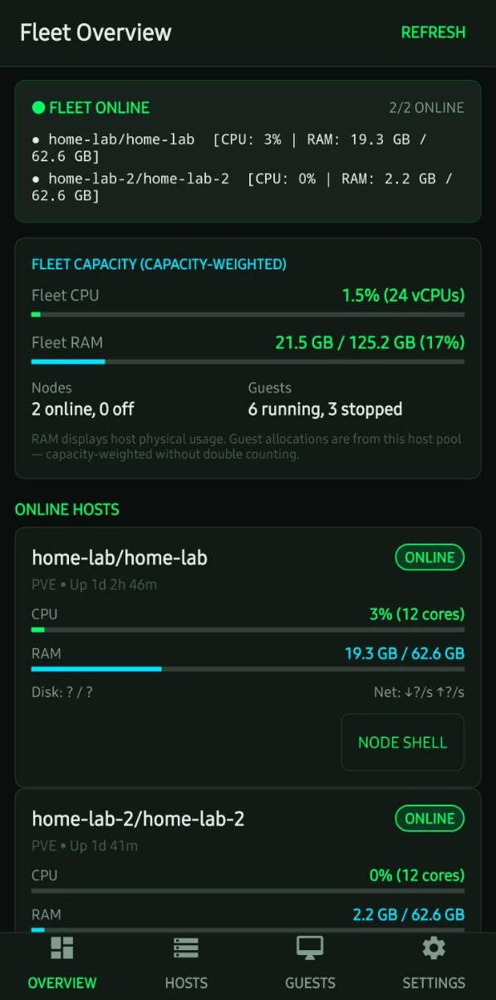
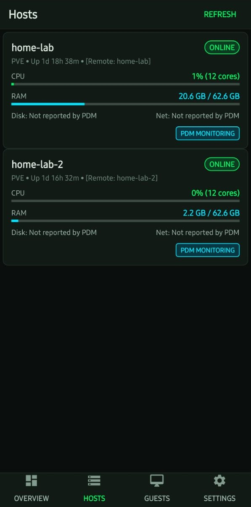
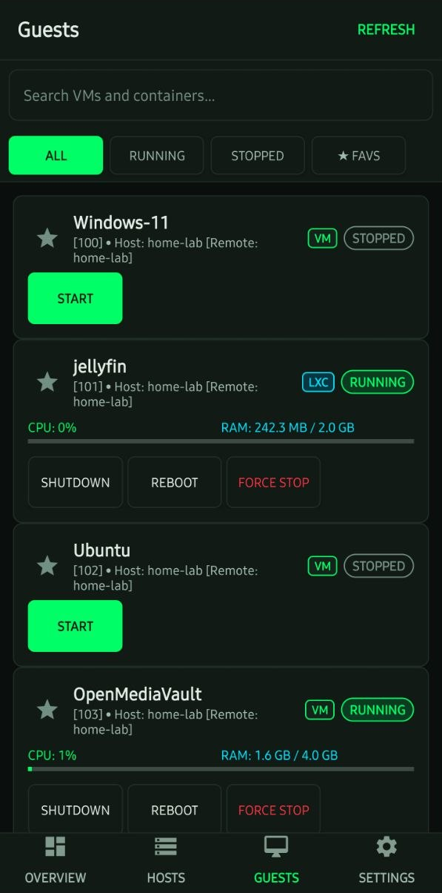
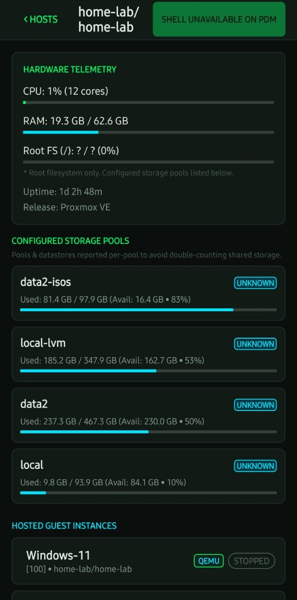

# PVE Pocket

A native Android app for monitoring Proxmox VE (PVE) hosts and guests, with read-only fleet monitoring through Proxmox Datacenter Manager (PDM).

**Android 8.0+ · GPL-3.0-or-later · Early alpha**

## Download

**Latest published version: [v0.1.1-alpha](https://github.com/CrashxZ/pve-pocket/releases/tag/v0.1.1-alpha)** — includes the PDM HttpOnly-cookie login fix.

- **[Download the Android APK](https://github.com/CrashxZ/pve-pocket/releases/download/v0.1.1-alpha/pve-pocket-v0.1.1-alpha.apk)**
- [Release notes and checksum](https://github.com/CrashxZ/pve-pocket/releases/tag/v0.1.1-alpha) · [All releases](https://github.com/CrashxZ/pve-pocket/releases) · [Changelog](CHANGELOG.md)

This is a **debug-signed test release**, not a production-ready client. The [0.1.2 UI follow-up](docs/ROADMAP.md) is in development and is **not included** in this download.

## Screenshots

Real Android captures of **v0.1.1-alpha** connected to a live PDM deployment; system bars are cropped. These show the released app, not UI mockups.

<table>
  <tr>
    <td align="center"><br><strong>Overview</strong></td>
    <td align="center"><br><strong>Hosts</strong></td>
  </tr>
  <tr>
    <td align="center"><br><strong>Guests</strong></td>
    <td align="center"><br><strong>Node and storage</strong></td>
  </tr>
</table>

## What works

| Capability | Direct PVE connection | PDM connection |
| --- | --- | --- |
| Endpoint | PVE API, usually port `8006` | PDM API, usually port `8443` |
| Inventory | Hosts, QEMU VMs and LXC containers | Read-only inventory across remotes |
| Monitoring | CPU, memory, uptime and storage, subject to API permissions | Available fleet/node/guest metrics; some fields are missing |
| Guest power actions | Start, stop and reboot, subject to permissions | **Unsupported; disabled** |
| Shell and console | External SSH only when a target can be verified; browser fallback opens the management UI | **No remote shell or power routing**; management UI browser fallback only |

Built-in interactive terminal streaming is **not supported** on either backend. The browser fallback is not a selected guest's console.

The app uses native Android views without an embedded WebView dependency. Credentials are encrypted with AES-GCM through Android Keystore; connections support certificate fingerprint pinning and a device-credential/biometric session lock. TLS verification bypass is an explicit per-server opt-in with a persistent warning; leave it disabled. There are no third-party analytics or tracking SDKs.

## Install and connect

1. Download the release APK above and compare its SHA-256 with the release notes.
2. Open it on Android 8.0 or newer and allow installation from that source when prompted.
3. Add your PVE or PDM endpoint and credentials. Use a reachable trusted network or VPN, grant only the permissions you need, and verify the server certificate fingerprint through a trusted channel.
4. Select the connection to browse hosts and guests. Use a direct PVE connection for supported guest power actions; PDM mode is read-only.

The published v0.1.1 APK uses the same signing certificate as v0.1.0 and can upgrade that release. Locally built and GitHub Actions APKs may use different debug keys and cannot necessarily replace an existing install. The application ID remains `com.homelabpocket` for upgrade continuity.

## Alpha limitations

- **Incomplete device coverage:** user-provided phone screenshots confirm live PDM login and inventory, not comprehensive device acceptance or live PVE power-action qualification. Automated JVM tests are not device tests.
- **Missing PDM metrics:** root filesystem, disk/network rates and storage types may display `?`, a zero placeholder or `UNKNOWN`. A missing value does **not** mean zero usage. Root filesystem usage is distinct from configured datastore capacity.
- **Unpolished UI:** composite remote/node names, unavailable-action buttons and refresh styling remain visible in v0.1.1. See the [unreleased UI roadmap](docs/ROADMAP.md).
- **Storage errors:** configuration and credentials span separate preference files. Saves are not crash-atomic, and rollback is not guaranteed if recovery writes fail. Review saved endpoints after a storage error before reconnecting.
- **Debug signing:** this alpha and CI builds are for testing. Production release signing is not configured in the default workflow.

See [verification and signing details](VERIFICATION.md) for version-scoped evidence and [SECURITY.md](SECURITY.md) for security reporting.

## Build from source

The project uses a shell build pipeline, not a Gradle wrapper. Clone the repository first:

```bash
git clone https://github.com/CrashxZ/pve-pocket.git
cd pve-pocket
# Optional: build the published release instead of current main.
git checkout v0.1.1-alpha
```

### Ubuntu / Debian x86_64

Install **JDK 17** and the [Android SDK command-line tools](https://developer.android.com/studio#command-tools). Set `JAVA_HOME` to your JDK 17 installation, set `ANDROID_SDK_ROOT` to your SDK directory, and put `sdkmanager` on `PATH`. Then:

```bash
sudo apt-get update
sudo apt-get install -y openjdk-17-jdk junit4 libhamcrest-java libandroid-json-java zipalign
sdkmanager --licenses
sdkmanager "platforms;android-29" "build-tools;29.0.3"
export ANDROID_HOME="$ANDROID_SDK_ROOT"
bash tools/build.sh
```

JDK 17 matches the [GitHub Actions workflow](.github/workflows/ci.yml); newer JDKs can be incompatible with this legacy SDK's D8.

### Raspberry Pi / Debian ARM64

The [ARM64 bootstrap](tools/bootstrap-tools.sh) downloads a user-local JDK 21 and Android toolchain; it requires network access, `curl`, `unzip`, `tar`, and Debian package tools/repositories. It is an alternative to the x86_64 SDK setup, not an additional step.

```bash
bash tools/bootstrap-tools.sh
source tools/env.sh
bash tools/build.sh
```

Both paths compile the app, run the JVM behavioral suite, package and sign **`artifacts/pve-pocket-debug.apk`**. Fresh ARM64 bootstrap downloads were not re-qualified for v0.1.1; see [verification details](VERIFICATION.md). Build outputs and signing keys must not be committed.

## Roadmap

The next focus is [0.1.2 UI polish](docs/ROADMAP.md): clearer missing-metric states, readable remote/node names, less clutter in PDM mode, and consistent controls. This is development work, **not a published release or a promise of new PDM management support**.

[Report a bug or request a feature](https://github.com/CrashxZ/pve-pocket/issues). Do not include credentials, private keys or sensitive server details.

## License and attribution

Licensed under the [GNU General Public License v3.0 or later](LICENSE). See [NOTICE.md](NOTICE.md) for third-party notices and [SECURITY.md](SECURITY.md) for vulnerability disclosure.

Application and tests authored with Antigravity; independently reviewed and released with Hermes. Maintained by [Mainak Mondal / CrashxZ](https://github.com/CrashxZ).
